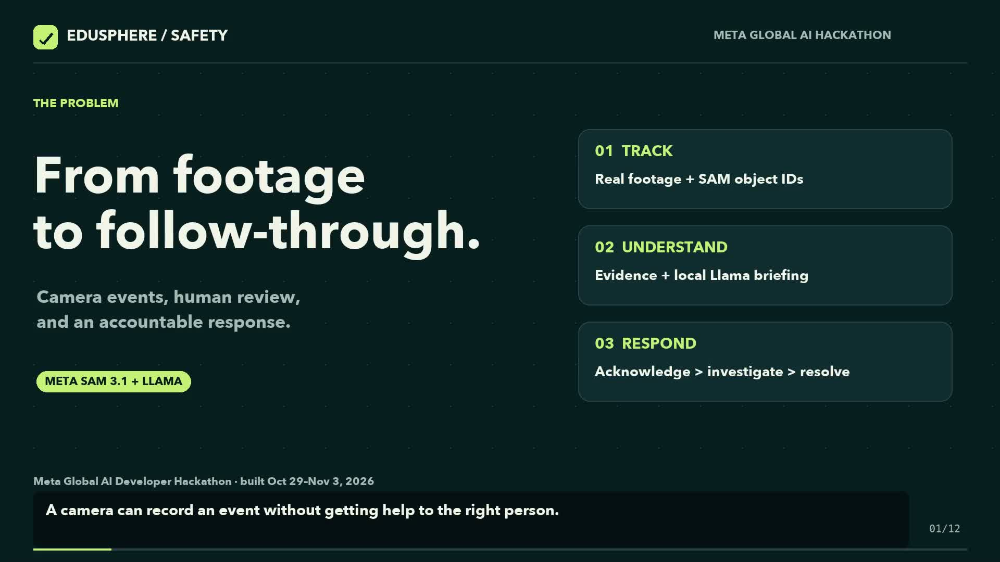

# EduSphere Safety

Turn school camera events into an accountable staff response. **Built with Meta Llama.**

EduSphere Safety combines a school-side video pipeline, scheduled safety rules,
tenant-scoped incident management, evidence review, local Llama incident briefings,
and staff acknowledgement, investigation and resolution.

Built for the **Meta Global AI Developer Hackathon 2026**, under **Build for Your
World**. This is a working prototype, with explicit simulation and deployment
boundaries. It does not replace supervision or physical safety measures.

- [Watch the three-minute demo on YouTube](https://www.youtube.com/watch?v=3fFxLrLHKA8)
- [Download the MP4 and captions](https://github.com/vicosoft4real/edusphere-safety/releases/tag/hackathon-demo)
- [Detailed judge's guide](submission/JUDGES_GUIDE.md)
- [Submission answers](submission/SUBMISSION_ANSWERS.md)
- [Architecture and original design](docs/superpowers/specs/2026-10-29-edusphere-safety-design.md)
- [Operator configuration](docs/operator-notes.md)

[](https://www.youtube.com/watch?v=3fFxLrLHKA8)

## What runs

```text
School camera / test footage
  → FFmpeg → detector → tracker → scheduled rules → persistent edge outbox
  → explicit demo handoff → .NET API → PostgreSQL incidents + notification worker
  → Next.js staff console → evidence review → acknowledge → investigate → resolve
                          ↘ local Meta Llama 3.2 → briefing + checklist + unknowns
```

The edge host supports a checksum-verified YOLOX ONNX person detector and a
deterministic manifest-replay detector for testing. The submission demo uses
synthetic footage and replayed detections, and labels that choice. It proves the
decode/track/rules workflow; it does **not** measure real-camera detection accuracy.

The current edge host writes an outbox. The demo harness explicitly sends those
events to the API and uploads supplied synthetic evidence. Automatic edge delivery
and live-camera clip extraction are not presented as finished.

## Meta model integration

The incident page's **Generate briefing** button calls a server-side route that
first checks the caller's tenant membership and access to the incident using the
real API, then requests a structured response from **Meta Llama 3.2 3B** running
locally in Ollama. The model receives event metadata, not camera images, video,
credentials, or staff identity. Its output contains a summary, human review
checklist, and explicit unknowns. Staff review the draft and retain every action.

```sh
ollama pull llama3.2
ollama serve # only if the Ollama app/server is not already running
```

Configure the web service with `OLLAMA_URL` (default `http://127.0.0.1:11434`)
and `LLAMA_MODEL` (default `llama3.2:latest`). No Meta API key is required for this
local open-weight integration. Model weights are downloaded separately and remain
under the [Llama 3.2 Community License](https://github.com/meta-llama/llama-models/blob/main/models/llama3_2/LICENSE).
The repository's MIT license does not relicense those weights.

## Run the local demonstration

Prerequisites: .NET 10 SDK, Node.js 22 LTS (22.13+) or 24 LTS, PostgreSQL with `psql`/`createdb`, FFmpeg,
Python 3, and Ollama with Llama 3.2. Local PostgreSQL must allow your OS user to
create and connect to a dedicated demo database. The recorded run used local
PostgreSQL 14; the deployment compose file targets PostgreSQL 17.

```sh
dotnet restore EduSphere.Safety.slnx
dotnet build EduSphere.Safety.slnx --no-restore
cd web && npm ci && cd ..
createdb -h 127.0.0.1 -U "$USER" edusphere_submission_demo
python3 submission/source/start-demo.py
python3 submission/source/prepare-demo.py setup
python3 submission/source/prepare-demo.py ingest
```

Open **http://127.0.0.1:3000**, use school `demo-school` and staff
`safety-officer`. All keys, logs, local evidence and email pickup files stay under
the ignored `.demo-runtime/` directory. The demo does not send email to real
recipients. It registers an example camera descriptor rather than claiming a
physical camera is connected.

`setup` enrolls a new device, creates a rule bundle and runs the synthetic pipeline.
`ingest` uses the event's stable ID to demonstrate duplicate suppression and uploads
the supplied synthetic clip. The demo handoff hashes the edge host's slash-separated
event ID into the cloud evidence API's 64-character identifier format. That mapping
is explicit in the harness; automatic edge/cloud transport remains future work.

The local login is deliberately a development stub. For deployment, configure
authentication, object storage, notifications and secrets using the operator notes.
Production single sign-on wiring in the web console is still pending.

## Validate

```sh
dotnet test tests/EduSphere.Safety.Tests
cd web && npm run typecheck && npm run lint && npm run build
```

The .NET integration tests require Docker; the video decode test requires FFmpeg.
**Measured on November 3, 2026: 509 existing .NET tests passed, 0 failed, 0 skipped.**
The submission also checks the live web/API flow, exact uploaded video bytes,
anonymous and cross-tenant refusals, real local Llama inference, and persisted
staff transitions. See [validation notes](submission/VALIDATION.md).

Do not run `next build` in the same output directory as an active `next dev`
server. Stop the development server first, or build in a separate checkout.

## Repository layout

| Path | Purpose |
| --- | --- |
| `src/EduSphere.Safety.Edge*` | Decoder, detector adapter, tracker, rules, local buffer and edge host |
| `src/EduSphere.Safety.Api` | Device authentication and staff-facing incident/evidence/configuration APIs |
| `src/EduSphere.Safety.Application` | Commands, validation, incident workflow and interfaces |
| `src/EduSphere.Safety.Infrastructure` | PostgreSQL repositories, migrations and evidence storage |
| `src/EduSphere.Safety.Worker` | Notification dispatch, escalation and retention |
| `web` | Next.js staff console and local Meta Llama briefing integration |
| `tools/Simulator` | Deterministic synthetic footage and ground truth |
| `tests` | Existing domain, pipeline, API and PostgreSQL tests |
| `submission` | Judge explanation, answers, video script and reproducible production sources |

MIT-licensed application code. Third-party libraries and models retain their own
licenses. YOLOX candidate provenance is in [docs/weights.md](docs/weights.md).
